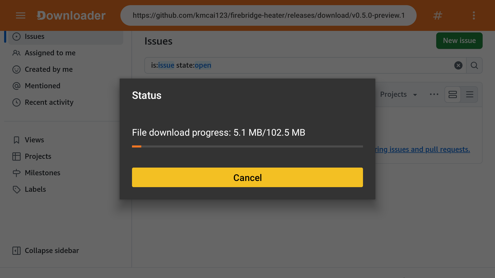
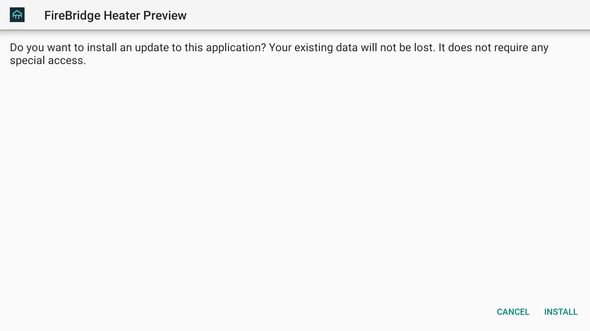
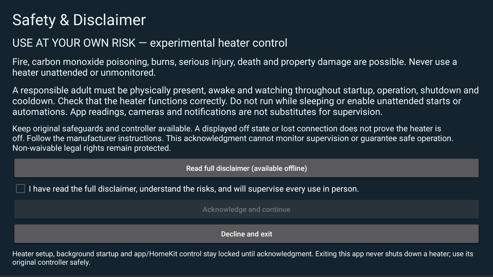
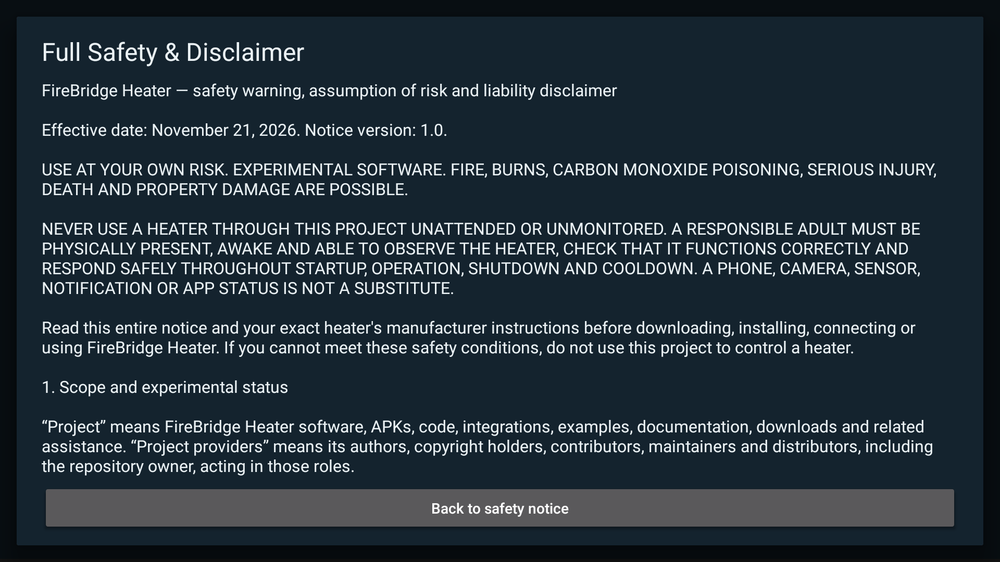
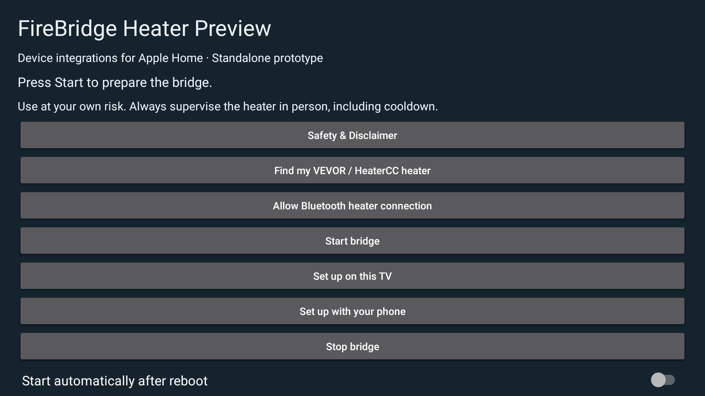
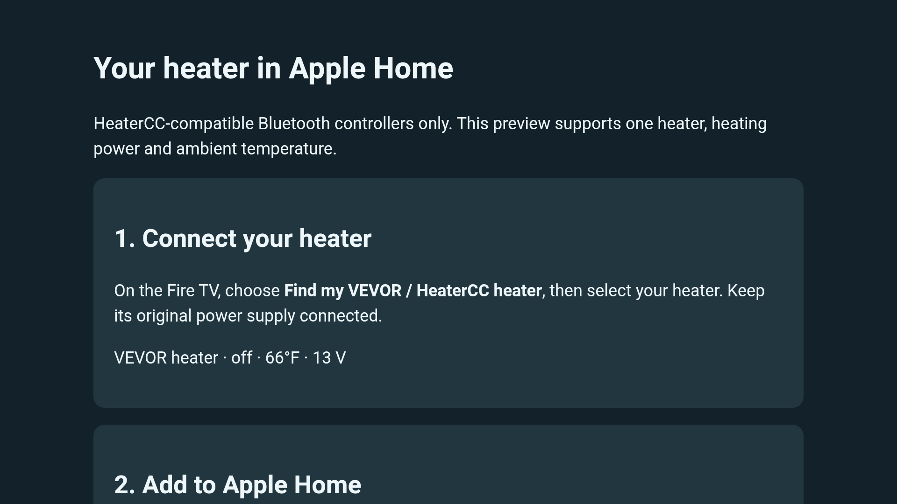
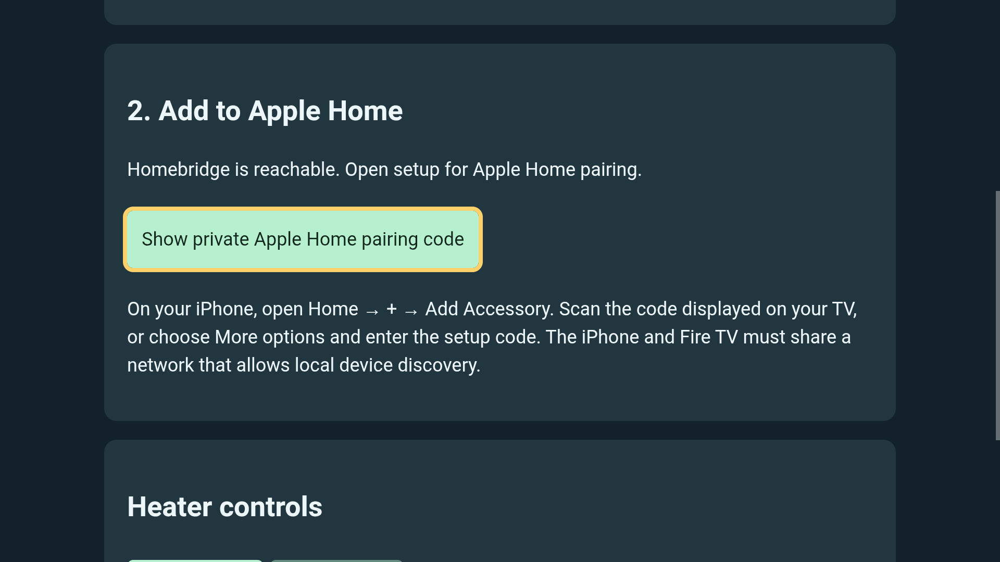

# Install FireBridge Heater Preview on Fire TV

> **WARNING — USE AT YOUR OWN RISK.** Experimental heater-control software can fail and may contribute to fire, carbon monoxide poisoning, serious injury, death or property damage. **Never operate a heater through this project unattended or unmonitored. A responsible adult must be physically present, awake and watching throughout startup, operation, shutdown and cooldown, and must verify that the heater functions correctly.** Do not rely on an app, camera or notification as a substitute. Do not enable unattended starts or automations.

>

> **Before downloading or using the APK, read the [full safety and liability disclaimer](DISCLAIMER.md).** Software is supplied as-is, with warranty and liability exclusions only to the extent permitted by law. Non-waivable legal rights remain protected.

**[Direct APK download: v0.5.1-preview.1](https://github.com/KMCAI123/firebridge-heater/releases/download/v0.5.1-preview.1/firebridge-heater-preview.apk)**

Enter this direct URL in Downloader. **Old code 2819860 still downloads v0.5.0 without the in-app warning; do not use it for this update.** A replacement numeric code is not yet published.

## Before you begin

You need:

- An **Android-based Fire TV**, Android API 26 or newer, ARMv7 or ARM64, with Bluetooth Low Energy. Not every Fire TV model supports this APK or sideloading.

- One **HeaterCC-compatible Bluetooth heater** within range. A VEVOR logo alone does not establish compatibility.

- A TV/monitor and Fire TV remote for initial setup, plus an iPhone with the Home app for pairing.

- Your normal home network. The Fire TV and iPhone must be able to discover each other locally; guest-network isolation can prevent this.

- Free storage for the approximately 102 MB APK, the installed app and its expanded runtime. The download size is not the total storage requirement.

No Home Assistant, cloud account, computer or extra bridge hardware is required for this installation path. Keep the heater on its original power supply. Close the vendor phone app or another Bluetooth bridge if it is already connected to the heater.

**Preview status:** discovery, status reading and remote navigation were tested on an AFTSSS Firestick with Fire OS 7 / Android 9. Apple Home pairing, heating commands, complete cooldown, reboot/standby recovery and extended streaming coexistence still need validation in this preview. Instructions for these steps are not evidence that they have passed testing.

## 1. Install Downloader and allow APK installation

1. From Fire TV Home, open **Find/Search** and search for **Downloader** by **AFTVnews**.

2. Install it from the Amazon Appstore, then open it.

3. Open Fire TV **Settings → My Fire TV → Developer Options**. On some devices, the category is called **Device & Software**.

4. If Developer Options is hidden, open **About**, highlight the device name and press the remote's **Select** button seven times, then go back.

5. Under **Install Unknown Apps**, enable **Downloader**. Older versions may instead have a general **Apps from Unknown Sources** switch.

ADB debugging is not needed for the Downloader installation path. You can turn Downloader's installation permission off again after installation, then enable it for a future update if needed. If your device offers no supported APK installation permission, do not assume this APK can bypass that restriction.

These menu names vary by firmware. We have not captured a fresh-device permission flow; there are no simulated settings screenshots in this guide. See [Amazon's Developer Options instructions](https://www.developer.amazon.com/docs/fire-tv/connecting-adb-to-device).

## 2. Download the APK

1. Open **Downloader**.

2. Select its URL/search/short-code field.

3. Enter `https://github.com/KMCAI123/firebridge-heater/releases/download/v0.5.1-preview.1/firebridge-heater-preview.apk` and choose **Go**.

4. Wait for the GitHub APK download to finish.

The screenshot below shows the earlier release downloading on the test Firestick. Use the new URL above for the safety-notice update; this image is not evidence of downloading the new version.

Only install the FireBridge APK linked from this repository. The short-code service is a third party; the public destination for this code can be checked at [2819860+](https://aftv.news/2819860+).

## 3. Install and open

1. When the Android installer appears, check that the app name is **FireBridge Heater Preview**.

2. Select **Install**, wait for completion, then select **Open**.

3. If Fire TV blocks the installation, return to step 1 and check the Downloader installation permission.

This screenshot shows an **update** prompt because our test stick already contained the development copy. A new user will see a new-install prompt. We cancelled this update because the public APK and private development copy have different signing keys. Reaching this screen confirms download and APK recognition, not completion of a public-build installation.

Once installed, you can reopen the app from Fire TV's apps list. Downloader may offer to delete the downloaded APK afterward; that removes the installer file, not the installed application.

## 3a. Read and acknowledge the safety notice

1. The first-launch screen warns about fire, carbon monoxide, injury and the need for continuous in-person supervision.
2. Open **Read full disclaimer (available offline)**. Scroll with the remote, then choose **Back to safety notice**.
3. Select the checkbox only after reading and understanding the notice. Choose **Acknowledge and continue**, or **Decline and exit** if you cannot meet the conditions.
4. Setup and app/HomeKit control remain locked until acknowledgment. Acknowledgment is saved locally for the specific notice version; future notice changes can require it again.
5. Reopen **Safety & Disclaimer** from the home screen at any time. Acknowledgment does not monitor actual supervision or make unattended operation safe.

These safety screens were tested in an isolated lightweight package on the Firestick, including decline, relaunch, the checkbox, persistence after restart and the permanent link. No heater commands were sent. The full signed distribution APK was built and inspected; installation over the working heater app was not performed.

## 4. Find your heater

1. Choose **Find my VEVOR / HeaterCC heater** using the remote.

2. If prompted, allow **Location** on older Android versions or **Nearby devices/Bluetooth** on newer ones. Older Android devices may also need location services enabled for BLE scanning; this app does not calculate geographic location.

3. Keep this screen open during the 15-second scan.

4. Select your heater from the results. The name may differ from the retail heater model.

5. Read the confirmation and select **Check heater** for a heater you own.

The app checks the Bluetooth service and requests live protocol status. Selecting a heater does **not** send a command to start heating. A name match alone is insufficient; the live-status check must succeed.

## 5. Confirm live status

Wait for first-launch runtime preparation and the Bluetooth connection to finish. The setup page should show the heater's state, ambient temperature and supply voltage.

The screenshot is a real test reading: **off, 66°F, 13 V**. Your values will differ. Do not assume a stale or unavailable reading confirms the current physical state.

If no heater appears, close its vendor app, ensure another bridge is not connected, check permissions, move the Fire TV closer and scan again. Bluetooth range depends on placement and obstructions.

## 6. Add the bridge to Apple Home

1. Scroll down with the remote to **Add to Apple Home**.

2. Wait for **Homebridge is reachable**.

3. Select **Show private Apple Home pairing code**. Use the code generated on **your own Fire TV**, not a screenshot from another installation.

4. On your iPhone, open **Home → + → Add Accessory**.

5. Scan the code displayed on the TV. If scanning is not practical, use the manual setup option and enter the displayed HomeKit code. Follow the prompts to select your home/room and name the accessories.

6. This preview is intended to expose a heating on/off accessory and an ambient-temperature sensor. It does not implement target-temperature or heat-level controls.

The screenshot intentionally stops before revealing a private pairing code. iPhone pairing has **not yet been completed in this preview's test record**, so no successful iPhone pairing screenshot is claimed. Apple's general instructions are available in [Set up accessories with Home](https://support.apple.com/en-euro/guide/iphone/iph125110541/27/ios/27).

## 7. Continuous supervision and every-use checks

Keep the Fire TV powered, connected to the network and within Bluetooth range. Turning off a TV may also remove power from its USB ports; a Firestick powered that way will stop acting as a bridge. Use the Fire TV's intended power supply.

The app includes **Start automatically after reboot**, but cold-start/standby reliability has not yet been validated. Verify current status after any restart. Remote access outside your home depends on your Apple Home configuration; this APK is not an Apple home hub.

Every operation requires a correctly installed heater and a responsible adult physically present and awake to observe it. Never operate unattended or while sleeping, and do not configure unattended starts or automations. Confirm physical operation and fresh status before relying on a control. An off request is intended to use the heater's normal cooldown; never interrupt heater power to simulate an off command. If confirmation is missing, check the heater's own controller rather than repeatedly sending power commands. Actual start/stop and completed cooldown remain untested in this preview.

## Troubleshooting

| Symptom | What to check |

| --- | --- |

| Old Downloader code installs the old version | Use the direct v0.5.1 APK URL above. The legacy code has not been redirected. |

| APK parsing/install error | Android version/ABI compatibility, sideloading support, free space and completed download. |

| Update fails on the original private test build | Its signing key differs. Do not uninstall or clear data without preserving its setup first. This does not affect a first-time public installation. |

| No heater found | Heater power, Bluetooth range, permissions and another app/bridge occupying its connection. |

| Found, but status never becomes valid | The controller may not use the supported HeaterCC protocol, or its connection may be unavailable. Branding/name does not prove compatibility. |

| Homebridge not reachable | Allow first-launch preparation to complete; inspect the app's status message and check free storage. Do not pair until ready. |

| Home cannot discover the bridge | Check that both devices share a LAN that permits discovery; avoid isolated guest networks. Keep the Fire TV running. |

| Accessory is unavailable | Check Fire TV power, Wi-Fi, bridge service and Bluetooth connection. An unavailable reading does not establish whether the heater is physically off. |

Phone setup uses an authenticated local HTTP page. Keep its private URL/QR and Apple Home code private, use a trusted LAN and do not forward setup ports to the internet.

## Updates, removal and help

Check [Releases](https://github.com/KMCAI123/firebridge-heater/releases) for updates. Public updates must retain the distribution signing key to preserve app data. Download the intended version and install it over the existing public app. The legacy numeric shortcut still points to the earlier release; use the current direct download link.

Uninstalling or clearing the app's data removes its local configuration and pairing identity. Stop the bridge when safe to do so, preserve anything needed for recovery, then remove the app through Fire TV settings. Do not treat uninstalling as a heater-off command. Removing/recreating a bridge may require removing the old accessory and pairing the new one in Apple Home.

For problems, [open an issue](https://github.com/KMCAI123/firebridge-heater/issues) with the Fire TV model, Fire OS version, heater/controller model, app version and exact error. Exclude pairing codes, setup URLs, passwords and unredacted logs.

All screenshots above come from the test Firestick. No private HomeKit codes, setup tokens or heater Bluetooth identifiers are published. See the [README](README.md) for licensing, signing and validation limits.

