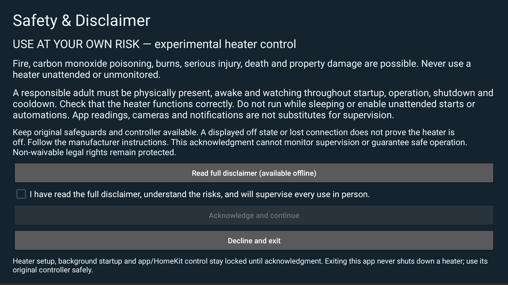
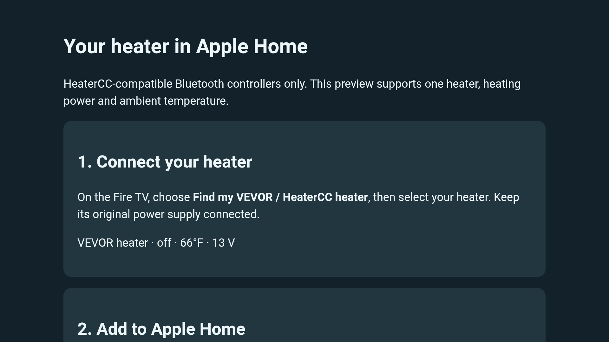

# FireBridge Heater Preview for Fire TV

> **WARNING — USE AT YOUR OWN RISK.** Experimental heater-control software can fail and may contribute to fire, carbon monoxide poisoning, serious injury, death or property damage. **Never operate a heater through this project unattended or unmonitored. A responsible adult must be physically present, awake and watching throughout startup, operation, shutdown and cooldown, and must verify that the heater functions correctly.** Do not rely on an app, camera or notification as a substitute. Do not enable unattended starts or automations.

>

> **Before downloading or using the APK, read the [full safety and liability disclaimer](DISCLAIMER.md).** Software is supplied as-is, with warranty and liability exclusions only to the extent permitted by law. Non-waivable legal rights remain protected.

Connect one compatible Bluetooth diesel heater to Apple Home using an existing Android-based Fire TV. No Home Assistant or additional bridge computer is required; Apple devices for Apple Home setup and any required Apple home hub are separate requirements.

**Experimental preview.** One HeaterCC heater completed a supervised start, normal startup confirmation, stop, cooldown telemetry and return-to-off telemetry on the test Firestick. Final physical fan-stop confirmation, Apple Home pairing, reboot/standby recovery and extended streaming coexistence remain unverified. The new AA55/AA66 adapters have offline tests only; no additional heater model has been physically validated.

## Apple Home equipment required

**To add this bridge to Apple Home, you need an iPhone or iPad with Apple's Home app, signed in to your Apple Account. A Firestick and heater alone are not enough for Apple Home setup.** Keep the Apple device and Firestick on the same local network during pairing.

For Apple Home access away from home, you also need a supported **Apple home hub**, such as a **HomePod, HomePod mini or Apple TV 4K**, configured for your home. The Firestick runs the heater bridge; it does **not** replace an Apple home hub. An iPad is not supported as a home hub on the current Apple Home architecture.

A home hub provides Apple Home features; it does not remove this project's requirement for an awake adult to supervise the heater in person. Do not configure unattended heater starts.

Apple's requirements: [Adding accessories requires an iPhone or iPad](https://support.apple.com/en-au/126198), [home hubs for remote access](https://support.apple.com/en-ie/guide/iphone/iph1d10f7f2b/ios), and [current home-hub requirements](https://support.apple.com/en-in/102096). Apple Home pairing remains unverified in this preview's test record.

## Download

**[Download v0.6.0-preview.1 with the in-app safety acknowledgment](https://github.com/KMCAI123/firebridge-heater/releases/download/v0.6.0-preview.1/firebridge-heater-preview.apk)** (approximately 102 MB).

**[Full step-by-step guide with Firestick screenshots](INSTALL.md)** · [Release and checksums](https://github.com/KMCAI123/firebridge-heater/releases/tag/v0.6.0-preview.1)

In Downloader, enter the direct APK URL above. **Legacy code 2819860 still downloads the older APK without an in-app disclaimer. Do not use that code for this update.** A replacement numeric code has not been published.

## Safety inside the app

On first launch or after an update requiring a new notice, open **Read full disclaimer**, return, check the acknowledgment box, then choose **Acknowledge and continue**. **Decline and exit** leaves setup and control locked. The full disclaimer is bundled offline and remains accessible through **Safety & Disclaimer** on the home screen and the local setup page.

Acknowledgment gates heater setup, native BLE commands, background startup and HomeKit power control. It does not detect whether an adult is actually supervising, does not make unattended operation safe, and does not establish a legally effective waiver of non-waivable rights.

The complete 0.5.1 development APK and its safety acknowledgment were tested on the Firestick. The 0.6.0 update passes 29 Node tests, 888 native/Node protocol vectors and Android build/lint checks. These tests do not establish compatibility or safe operation on an untested heater.

## Install and set up

1. On a compatible Android-based Fire TV, install/open Downloader. Enable permission for Downloader to install unknown apps in the Fire TV developer settings. Names and availability vary by Fire TV model. This permission is required for Downloader; the APK cannot authorize itself.

2. Enter the direct APK URL above in Downloader and choose **Go**.

3. Install and open **FireBridge Heater Preview**. Read the offline disclaimer and complete the safety acknowledgment before setup becomes available.

4. Choose **Find my VEVOR / HeaterCC heater**. Allow Location on older Android versions, or Nearby devices on newer versions if prompted. Older devices may require location services enabled for BLE discovery. No geographic location is calculated by this app.

5. Close any vendor phone app or other bridge holding the heater's Bluetooth connection. Select your heater and choose **Check heater**. This sends status requests, not a heating command.

6. Wait for current heater status, then select **Show private Apple Home pairing code**.

7. On your iPhone, open Home, choose **+ → Add Accessory**, and scan the displayed code or enter it manually via More Options. The iPhone and Fire TV must have local network discovery access to each other.

Keep the Fire TV powered and within Bluetooth range. The app supports an on/off heating accessory and ambient temperature sensor, not target-temperature or heat-level adjustment. Apple remote-access capability does not authorize unattended heating: an adult must still be physically present at the heater throughout operation.

See the [illustrated setup guide](INSTALL.md) for every step and troubleshooting.

## Compatibility and evidence

- Android API 26 or newer; ARMv7 or ARM64; Bluetooth Low Energy.

- Not compatible with every Fire TV generation or non-Android Fire TVs.

- VEVOR branding alone is insufficient. HeaterCC/ABBA is supported; AA55, AA66, AA55-XOR and AA66-XOR are experimental and require matching live status frames. Only the default AirHeaterBLE passkey 1234 is supported. AA77 and Hcalory/Sunster/Warm Drive/HeatGenie power control are not enabled.

- Tested: AFTSSS Firestick, Fire OS 7 / Android 9, 32-bit ARM. APK installation through PC ADB, remote-button navigation, heater discovery and valid status were successful. Homebridge reported reachable. The earlier v0.5.0 public GitHub APK also downloaded successfully through Downloader 2.0.4 on the Firestick and reached the Android installer; installation of that differently signed release was cancelled to preserve the existing test app.

- Not yet tested: Additional physical heater models, iPhone Apple Home pairing, final physical fan-stop confirmation, fresh-device Downloader permissions, cold boot, standby and prolonged operation.

- The APK is about 102 MB and expands its runtime on first launch; allow ample free storage beyond the download size.

Use only with a correctly installed heater and its original controller/power supply. Keep normal heater safety systems intact. Do not depend on this preview as a safety control. Every use must be continuously supervised in person, including shutdown and cooldown. See [the full disclaimer](DISCLAIMER.md).

## Privacy and local access

The app creates fresh local setup credentials and HomeKit pairing identity on the user's own Fire TV. The release contains no developer account credentials, heater pairing state or saved home configuration. Phone setup uses bearer-authenticated HTTP on a trusted LAN; keep the setup URL/QR private. Do not expose setup ports to the internet.

## Updates and signing

Package: `net.localbridge.tv.heaterpreview`. This public release uses a dedicated distribution signing key. Future APK updates must retain that key. The earlier privately sideloaded developer build used a different key and cannot be upgraded in-place to this public release. Back up that private build's state before replacing it. Normal new users do not have that development copy installed.

The v0.6.0 distribution APK retains the public signing certificate (versionCode 7), offline notice and complete runtime. Public-key-signed installations can upgrade in place. The test Firestick uses an otherwise equivalent development-signed APK to preserve its existing data. Checksums and certificate details are included; a clean-machine reproducible build has not yet been established.

## Notices

This is an independent project, not an official VEVOR, Amazon, Apple or Homebridge product. Third-party software retains its own licenses; bundled runtime notices and an additional `THIRD-PARTY-NOTICES.zip` are supplied with the release. The repository currently distributes the preview APK and documentation; it is not a complete source/build repository.

Report your Fire TV model, Fire OS version and heater model when opening an issue. Do not post setup codes, private URLs, passwords or unredacted logs.

## 0.6.0 protocol update

See [adapter behavior and limits](docs/HEATER_TWO_WAY_0.6.0.md), [Android app inspection](docs/HEATER_ANDROID_APP_AUDIT.md), and [physical test evidence](docs/HEATER_SUPERVISED_TEST_2026-11-22.md). Existing safety acknowledgment and cooldown guards remain. No automatic command retries are added. Historical screenshots illustrate the same setup flow and may show an older version.
